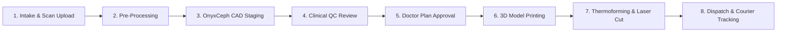

# 📖 SmileGenix / VelourCare Ortho Cloud — Complete Operator & User Manual

> **System URL:** `http://localhost:8000`  
> **Source Directory:** `D:\Antigravity\velourcare-ortho-cloud`  
> **Interface Template:** Velzon Bootstrap 5 & Vue 3 Architecture  
> **Backend Service:** Node.js Express REST API + Laravel Sanctum Simulation  

---

## Table of Contents
1. [Quick Start & Server Management](#1-quick-start--server-management)
2. [Interface Layout & Navigation](#2-interface-layout--navigation)
3. [Patient Case Management (End-to-End Workflow)](#3-patient-case-management-end-to-end-workflow)
   - [3.1 Creating a New Case](#31-creating-a-new-case)
   - [3.2 Pre-Processing & 3D Scan Mesh Ingestion](#32-pre-processing--3d-scan-mesh-ingestion)
   - [3.3 Treatment Plan Staging & 3D Viewer](#33-treatment-plan-staging--3d-viewer)
   - [3.4 Interproximal Reduction (IPR) & Attachments](#34-interproximal-reduction-ipr--attachments)
   - [3.5 Clinical Approval & Manufacturing Authorization](#35-clinical-approval--manufacturing-authorization)
   - [3.6 Packaging, Courier Dispatch & DHL Tracking](#36-packaging-courier-dispatch--dhl-tracking)
4. [Billing, Invoicing & Stripe Integration](#4-billing-invoicing--stripe-integration)
5. [Clinic, Partner & Vendor Directory](#5-clinic-partner--vendor-directory)
6. [API Credentials, Webhooks & Developer Hub](#6-api-credentials-webhooks--developer-hub)
7. [User Roles & Permission Security](#7-user-roles--permission-security)
8. [Troubleshooting & Maintenance](#8-troubleshooting--maintenance)

---

## 1. Quick Start & Server Management

### Starting the Server
Open PowerShell and run:
```powershell
cd "D:\Antigravity\velourcare-ortho-cloud"
node server.js
```

### Accessing the Web Interface
Open your web browser and navigate to:
* **Dashboard:** [http://localhost:8000/dashboard](http://localhost:8000/dashboard)
* **Cases List:** [http://localhost:8000/cases](http://localhost:8000/cases)
* **Invoices:** [http://localhost:8000/invoices](http://localhost:8000/invoices)

### Verifying Port Availability
If port `8000` is already occupied by another service:
```powershell
Get-NetTCPConnection -LocalPort 8000 -ErrorAction SilentlyContinue
```
You can change the port in `server.js` or set an environment variable:
```powershell
$env:PORT=8080; node server.js
```

---

## 2. Interface Layout & Navigation

The portal utilizes the **Velzon enterprise layout** with three main structural areas:

```
+--------------------------------------------------------------------------+
|  [Logo]  |  [Search...]       [Language]  [Notifications]  [User Avatar] |
+----------+---------------------------------------------------------------+
| SIDEBAR  | MAIN WORKSPACE                                                |
|          |                                                               |
|  Dash   |   Breadcrumb: Dashboard > Patient Cases                       |
|  Cases  |   +-------------------------------------------------------+   |
|  Clinic |   | KPI Metrics: 104 Cases | 21 Refinements | 15 Retainers|   |
|  Invoic |   +-------------------------------------------------------+   |
|  Users  |   | Filterable Data Grid / Treatment Reviewer             |   |
|  Roles  |   |                                                       |   |
|  API    |   +-------------------------------------------------------+   |
+----------+---------------------------------------------------------------+
```

### Sidebar Navigation Shortcuts:
* **Dashboard (`/dashboard`):** Real-time operational overview and high-level case counters.
* **Cases (`/cases`):** Master patient database, stage progression, clinical notes, and approvals.
* **Clients (`/clients`):** Main dental clinic accounts and contract tiers.
* **Sub-Clients (`/sub-clients`):** Branch practices and satellite dental clinics.
* **Vendors (`/vendors`):** Dental manufacturing labs and CAD design contractors.
* **Invoices (`/invoices`):** Billing ledger, Stripe settlements, and downloadable PDF receipts.
* **Users (`/users`):** Doctors, CAD technicians, QC managers, and admin accounts.
* **Bank Accounts (`/bank-accounts`):** Clinic direct wire details for bank payouts.
* **Stripe Platform (`/settings/stripe-platform`):** Stripe API credentials and live charges.
* **Stripe Connect (`/settings/stripe-connect`):** Automated vendor and clinic split payouts.
* **API Credentials (`/settings/client-api-credentials`):** REST API token vault for clinic EMR/PMS integrations.
* **API Docs (`/api-documentation`):** OpenAPI reference and webhook event schemas.
* **Roles (`/roles`):** Role-based access control (RBAC) permission matrices.

---

## 3. Patient Case Management (End-to-End Workflow)

Every patient orthodontic treatment follows an 8-stage clinical lifecycle:



### 3.1 Creating a New Case
1. Navigate to **Cases** (`/cases`).
2. Click the green **`+ Add Case`** or **`New Intake`** button.
3. Complete the clinical submission form:
   * **Patient Full Name & Age:** Required for biological movement limits.
   * **Malocclusion Classification:** Select Class I, Class II Div 1, Class III, Deep Bite, or Open Bite.
   * **Arch Selection:** Upper only, Lower only, or Dual Arch.
   * **Intraoral Scans:** Drag-and-drop Upper & Lower STL/PLY files.
   * **Clinical Prescription Notes:** Specific instructions regarding teeth extractions, midline correction, or IPR limits.
4. Click **`Submit Case`**. The case is assigned an auto-incrementing ID (e.g., `APX-2026-9041`).

### 3.2 Pre-Processing & 3D Scan Mesh Ingestion
* Files uploaded are stored in `D:\Antigravity\velourcare-ortho-cloud\uploads`.
* The system checks STL integrity (watertight mesh verification, coordinate alignment, and gingival margin trimming).
* Status updates automatically to: **`PRE_PROCESSING`**.

### 3.3 Treatment Plan Staging & 3D Viewer
1. Click on any case row in `/cases` to open its Case Detail view.
2. Select the **`Treatment Plans`** tab.
3. The interactive 3D plan displays:
   * **Stage Scrubber:** Move from **Stage 0** (Pre-treatment) to **Stage 24** (Target alignment).
   * **Arch Selector:** Toggle between Upper Arch, Lower Arch, or Both in Occlusion.
   * **Occlusal Contact Map:** Visualizes inter-arch pressure points.

### 3.4 Interproximal Reduction (IPR) & Attachments
* **IPR Matrix:** Shows exact interproximal enamel reduction required (e.g. `11-21: 0.3mm at Stage 3`).
* Check the **`Performed`** checkbox once the clinical stripping is executed chairside.
* **Attachments:** Displays placement templates (Beveled Optimized, Vertical Rectangular, Ellipsoid Rotational).

### 3.5 Clinical Approval & Manufacturing Authorization
* **Approve Plan:** The prescribing orthodontist clicks **`Approve Treatment Plan`**. This locks the 3D movement schedule and automatically moves the case into **`MANUFACTURING_3D_PRINT`**.
* **Request Revision:** If movements require modification, click **`Request Revision`**, type specific notes (e.g., *"Expand upper premolars by 0.5mm to avoid anterior IPR"*), and click Submit.

### 3.6 Packaging, Courier Dispatch & DHL Tracking
* Once 3D printing and Zendura aligner thermoforming are completed on the lab floor:
* The technician clicks **`Mark Dispatched`**.
* Enter courier details (`DHL Express Medical`) and the tracking number.
* The portal generates the courier tracking badge and updates the clinic via webhook.

---

## 4. Billing, Invoicing & Stripe Integration

### Invoice Generation
* Every approved case automatically generates an itemized invoice under **Invoices** (`/invoices`).
* Line items include:
  * Aligner Package Tier (e.g., Comprehensive 24-Stages: `$1,200.00`).
  * 3D Digital Setup & OnyxCeph Staging (`$150.00`).
  * Premium Zendura FLX Multi-Layer Material (`$100.00`).
  * Priority FedEx/DHL Delivery (`$50.00`).

### Settling Payments via Stripe
1. Open `/invoices` and locate pending invoices.
2. Click **`Pay with Stripe`**.
3. The integrated Stripe Connect modal processes the transaction and records an immutable receipt ID (`ch_3PzK...`).
4. Invoice badge shifts from `PENDING PAYMENT` to `PAID & SETTLED`.

---

## 5. Clinic, Partner & Vendor Directory

### Managing Dental Practices (`/clients`)
* Add new clinic partnerships with customized contract pricing.
* Assign dedicated account managers and link parent practices to satellite clinics in **`/sub-clients`**.

### Managing Manufacturing Labs (`/vendors`)
* Allocate specific case volumes to specialized aligner manufacturing labs based on regional proximity or capacity.

---

## 6. API Credentials, Webhooks & Developer Hub

### Clinic API Tokens (`/settings/client-api-credentials`)
* Clinic partners can integrate their EMR (Electronic Medical Record) software with the portal.
* Generate bearer API tokens with granular read/write permissions.

### Outbound Webhook Integration
Configure your clinic HTTPS webhook URL under **`/api-documentation`** to receive real-time push events:
* `case.created` — Fired when a clinic submits a new case.
* `treatment_plan.ready_for_review` — Fired when CAD staging is ready for doctor inspection.
* `treatment_plan.approved` — Fired when doctor signs off on 3D movements.
* `manufacturing.started` — Fired when 3D printing starts.
* `shipping.dispatched` — Fired with tracking URL upon dispatch.

**HMAC Signature Verification:**
All webhook payloads include the header:
```http
X-Webhook-Signature: sha256=e3b0c44298fc1c149afbf4c8996fb92427ae41e4649b934ca495991b7852b855
```
Verify the payload using your secret key to prevent spoofing.

---

## 7. User Roles & Permission Security

The portal enforces strict Role-Based Access Control (RBAC):

| Permission / Action | Clinic Doctor | CAD Technician | QC Director | Platform Admin |
| :--- | :---: | :---: | :---: | :---: |
| Submit New Patient Cases | ✅ | ❌ | ❌ | ✅ |
| Upload 3D STL & Staging Models | ❌ | ✅ | ❌ | ✅ |
| Approve / Reject Clinical QC | ❌ | ❌ | ✅ | ✅ |
| Approve Treatment Plan | ✅ | ❌ | ❌ | ✅ |
| Settle Invoices (Stripe) | ✅ | ❌ | ❌ | ✅ |
| Manage System API Keys | ❌ | ❌ | ❌ | ✅ |
| View Security Audit Logs | ❌ | ❌ | ✅ | ✅ |

---

## 8. Troubleshooting & Maintenance

### Port 8000 Already in Use
To stop any lingering node process holding port 8000:
```powershell
Get-Process node -ErrorAction SilentlyContinue | Stop-Process -Force
node "D:\Antigravity\velourcare-ortho-cloud\server.js"
```

### Resetting Seed Data
To restore the cases database to clean initial states:
* Stop the server.
* Delete or restore `data/` JSON stores if modified.
* Restart `node server.js`.

### File Uploads Location
All patient intraoral scans, photos, and prescription attachments are stored in:
📂 `D:\Antigravity\velourcare-ortho-cloud\uploads`
